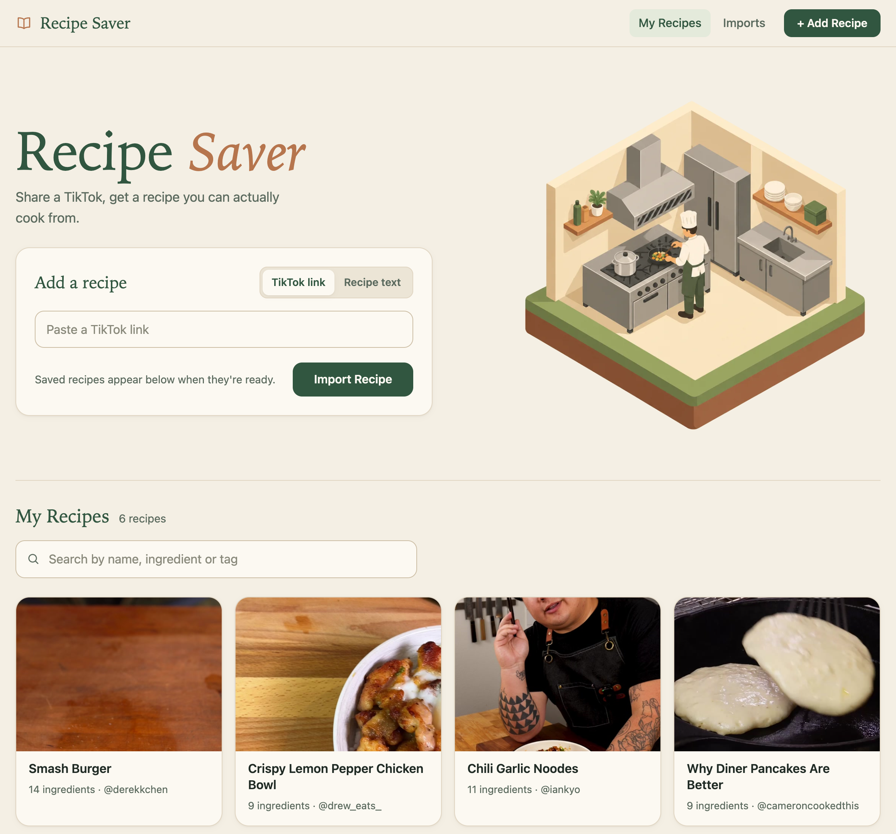
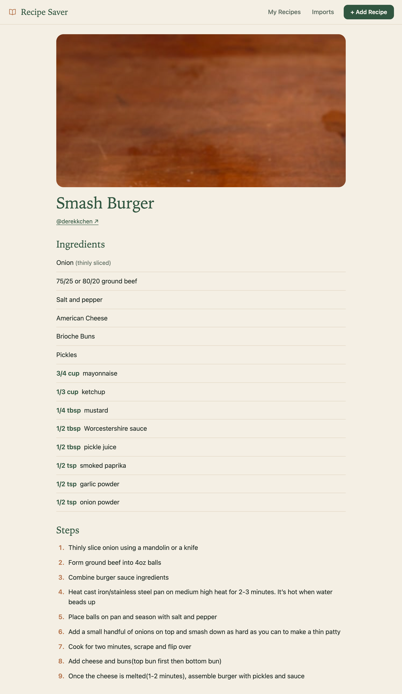
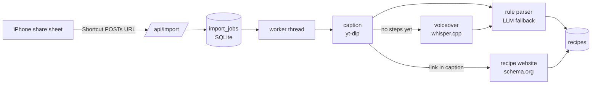

# recipe-saver

[](https://github.com/vincentgoh0902/recipe-saver/actions/workflows/tests.yml)
https://github.com/user-attachments/assets/8b052ad6-0c3f-43f9-9868-d180481ba96b

Share a TikTok to an iPhone Shortcut and get a clean recipe card: ingredients with
quantities, numbered steps, and a link back to the video. Self-hosted on a private
Tailscale network; no paid APIs.

The importer reads the caption first, then a recipe website linked from the caption,
then the voiceover (transcribed locally with whisper.cpp), and stops once it has both
ingredients and steps. A small local LLM handles captions and voiceovers the rule-based
parser can't. See `docs/PRD.md` for the full spec.

## Screenshots



<p align="center">
  
</p>

The recipe above was imported from
[a TikTok by @cameroncookedthis](https://www.tiktok.com/@cameroncookedthis/video/7431609541676043551).

## How it works



- **Cheapest source first.** Captions are parsed by a rule-based parser in milliseconds;
  the LLM (a 3B model, JSON-schema constrained) only runs when the rules don't trust their
  result. On the 14 sample captions: 12/14 correct with rules alone, 14/14 with the fallback.
- **No paid APIs, no GPU.** Speech-to-text is whisper.cpp `base.en` on CPU; the LLM is any
  OpenAI-compatible server (Ollama, llama.cpp). The app peaks around 450 MB.
- **No extra infrastructure.** The job queue is a SQLite table plus one worker thread;
  jobs interrupted by a restart are requeued at startup.
- **Evaluated, not eyeballed.** `tests/fixtures/` holds 14 captions and 13 voiceover
  transcripts with hand-written expected results, scored by `scripts/eval_*.py`.

## Run it

Locally (Python 3.11+, [uv](https://docs.astral.sh/uv/)):

```sh
brew install whisper-cpp ollama && brew services start ollama && ollama pull qwen2.5:3b
mkdir -p models && curl -L -o models/ggml-base.en.bin \
  https://huggingface.co/ggerganov/whisper.cpp/resolve/main/ggml-base.en.bin
DATA_DIR=data/dev uv run python -m recipe_saver     # http://localhost:8000
```

With Docker (linux/arm64):

```sh
docker compose up --build    # uses Ollama on the host for the LLM
```

## Configuration

| Variable | Default | |
|---|---|---|
| `PORT` | `8000` | HTTP port, listens on 0.0.0.0 |
| `DATA_DIR` | `/data` | `recipes.db` and `thumbs/` |
| `LLM_BASE_URL` | `http://localhost:11434/v1` | Any OpenAI-compatible server |
| `LLM_MODEL` | `qwen2.5:3b` | |
| `LLM_TIMEOUT` | `120` | Seconds per LLM request; ~300 on a CPU-only server |
| `WHISPER_BIN` / `WHISPER_MODEL` | `whisper-cli` / `models/ggml-base.en.bin` | Set in the image |

Memory: about 450 MB peak for the app (during transcription), plus the LLM server
(~2.5 GB for `qwen2.5:3b`).

## API

`POST /api/import` queues an import and returns at once:

```sh
curl -X POST http://localhost:8000/api/import --json '{"url": "https://vt.tiktok.com/..."}'
# {"job_id": 7, "status": "queued", "status_url": "/api/jobs/7"}
```

The body can also be a form field (`url` or `text`) or plain text, such as the share
sheet's "Check out this video! https://..."; the link is picked out of it. Pasted recipe
text works too. `GET /api/jobs/{id}` returns `status` (queued, fetching, transcribing,
parsing, done, failed), `error` and `recipe_id`. `GET /health` returns 200.

## Development

```sh
uv run pytest                      # LLM tests skip if no LLM is reachable
uv run scripts/eval_parser.py      # caption parser on the sample captions
uv run scripts/eval_audio.py       # voiceover parsing on the sample transcripts
```
